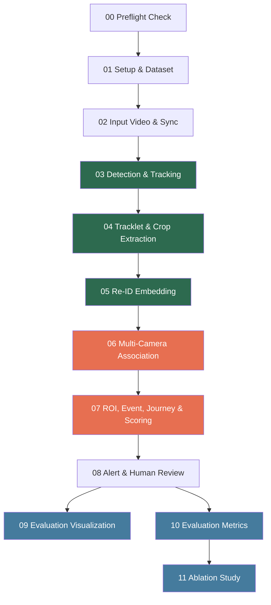

# Full Project Overview: Ticket Suspicion Multi-Camera Video Analytics

---

## 1. Problem & Objective

**Problem**: Detect suspected no-ticket visitors at an open tourism area (Hoi An context) using automated multi-camera video analytics.

**System Goal**: Generate **suspicion alerts** with visual evidence for **human verification**. The system does NOT conclude legal violations.

**Scientific Contribution**: Combines Computer Vision (detection, tracking, Re-ID) with business logic (ROI, journey state, scoring) into an end-to-end pipeline for real-world surveillance.

---

## 2. Pipeline Workflow — 12 Notebooks



> Green = Real MOT17 data | Orange = Partial simulation | Blue = Evaluation & Analysis

---

### NB00 — Preflight Check
- Validates directory structure, source files, config YAML
- Checks Python dependencies, YOLO model, GPU availability
- Scans MOT17 local dataset (seqinfo, sample images)
- Output: `00_preflight_check_results.csv`, `dataset_preflight_report.csv`

### NB01 — Setup & Dataset
- Detects project root (Vast.ai `/workspace`, Colab `/content`, or local)
- Creates directory tree and 4 YAML config files if missing
- Lists MOT17 sequences in `data/raw/MOT17/train`

### NB02 — Input Video & Sync
- Reads `camera_config.yaml` to determine data sources
- Scans MOT17 sequences in `train/` (7 scenes)
- Builds `frame_index.csv` with timestamp and metadata per frame
- Output: `outputs/frames/frame_index.csv`

### NB03 — Detection & Tracking
- Builds frame_index from MOT17/train, assigns `camera_id = sequence_name`
- **YOLOv8n** person detection (class=0, conf >= 0.35)
- **ByteTrack** multi-object tracking (`persist=True` per camera group)
- Tracker resets naturally between scenes (different camera_id)
- Output: `outputs/tracks/tracks.csv`

### NB04 — Tracklet & Crop Extraction
- Groups consecutive detections into tracklets (same camera_id + track_id)
- Computes metrics: duration, avg_confidence, avg_bbox_height
- Filters by config: min_frames=10, min_duration=1s, min_height=40px
- Selects top-K crops by quality (confidence + area + sharpness)
- Output: `outputs/tracklets/tracklets_summary.csv`, `outputs/crops/representative_crops.csv`

### NB05 — Re-ID Embedding
- Loads **OSNet (x1_0)** pretrained model
- Extracts 512-dim embeddings for each crop
- L2-normalizes, aggregates mean embedding per tracklet
- Output: `outputs/embeddings/crop_embeddings.npy`, `tracklet_embeddings.npy` + metadata CSVs

### NB06 — Multi-Camera Association & Global ID
- **Enhanced simulation**: Multi-difficulty noise (easy/medium/hard)
  - Easy: noise std=0.02
  - Medium: noise std=0.05
  - Hard: noise std=0.08 + 15% feature masking (partial occlusion)
- Difficulty assigned based on crop quality scores
- 60% of tracklets "appear at ticket counter"
- Cosine similarity + Hungarian matching
- Output: `outputs/associations/associations.csv`, `outputs/global_ids/global_ids.csv`

### NB07 — ROI Event, Journey & Scoring
- **Realistic event simulation**:
  - Poisson arrival process (inter-arrival ~ Exponential, ~3 people/min)
  - 30% group arrivals (2-4 people within 3s window)
  - Travel time ~ Normal(mu=180s, sigma=60s), clipped [30, 600s]
  - Dwell time ~ Log-normal (median ~20s), clipped [5, 120s]
- `build_journey_states()` -> 4 states:
  - `observed` | `ticket_evidence_found` | `waiting_for_ticket_evidence` | `suspected_no_ticket_evidence`
- `compute_suspicion_score()` -> weighted sum [0,1]
- `alert_level_from_score()` -> high/medium/low
- Output: `outputs/events/events.csv`, `outputs/journeys/journey_states.csv`, `outputs/alerts/alerts.csv`

### NB08 — Alert & Human Review
- Filters `high` alerts, copies top 3 crops to evidence folder
- Creates `summary.json` per alert with score and reason
- Creates `human_review.csv` (human_decision = "pending")

### NB09 — Evaluation Visualization
- Aggregate statistics and per-sequence breakdown
- **Qualitative Analysis**: Tracking visualization, crop quality showcase, alert examples
- **Failure Case Analysis**: Tracking fragmentation, false alerts, detection density
- Scoring sensitivity chart (alert count vs threshold)
- Alert distribution charts (status, score, journey state)
- Thesis table exports

### NB10 — Evaluation Metrics
- **CLEAR MOT Metrics**: MOTA, Precision, Recall, F1 per sequence vs MOT17 GT
- **Cross-Scene Re-ID Evaluation**: Positive/negative similarity histograms, ROC curve, AUC
- **Monte Carlo Validation**: 500-iteration scoring stability test
- Tracklet quality table, association statistics, evidence coverage
- Thesis summary table

### NB11 — Ablation Study
- **min_frames**: Tests [3,5,8,10,15,20,30] -> optimal range 8-15, current: 10
- **Re-ID threshold**: Tests [0.3-0.90] -> optimal range 0.50-0.65, current: 0.55
- **Scoring weights**: Tests 5 configurations -> default recommended
- **Alert threshold**: Tests [0.40-0.90] -> 0.70 confirmed balanced

---

## 3. Technical Architecture

### Models

| Component | Model | Details |
|-----------|-------|---------|
| Detection | **YOLOv8n** | Lightweight, real-time, COCO pretrained |
| Tracking | **ByteTrack** | SOTA MOT tracker, low-confidence association |
| Re-ID | **OSNet x1_0** | Omni-Scale feature learning, 512-dim |
| Matching | **Hungarian Algorithm** | Optimal assignment, cosine similarity |
| Scoring | **Rule-based** | Weighted sum, transparent, explainable |

### Source Code Modules (`src/`)

| Module | Function |
|--------|----------|
| `config.py` | Project root detection, YAML I/O, directory setup |
| `io_utils.py` | CSV/JSON/NumPy read/write |
| `dataset_preflight.py` | MOT dataset validation and reporting |
| `video_sync.py` | Frame index from sequences/video, seqinfo parsing |
| `roi_utils.py` | Point-in-polygon, line crossing detection |
| `journey_state.py` | Journey state classification per global_id |
| `scoring.py` | Suspicion scoring + alert level mapping |
| `evidence.py` | Evidence packaging + summary JSON |

### Configuration (4 YAML files)

| File | Content |
|------|---------|
| `pipeline_config.yaml` | Detector, tracker, tracklet, Re-ID, association params |
| `camera_config.yaml` | Camera sources, fps, sequence keywords |
| `roi_config.yaml` | Entrance line, ticket zone, queue zone polygons |
| `scoring_config.yaml` | Alert thresholds (0.70/0.50), weights, max travel time |

---

## 4. Data Flow

```
MOT17/train (7 scenes)
  |
  +--[NB03]--> tracks.csv (bbox + track_id per frame)
  |              |
  +--[NB04]--> tracklets_summary.csv + representative_crops.csv
  |              |
  +--[NB05]--> crop_embeddings.npy + tracklet_embeddings.npy
  |              |
  +--[NB06]--> associations.csv + global_ids.csv  (enhanced simulation)
  |              |
  +--[NB07]--> events.csv + journey_states.csv + alerts.csv  (realistic simulation)
  |              |
  +--[NB08]--> evidence/ + human_review.csv
  |              |
  +--[NB09]--> evaluation charts + qualitative visualizations
  |              |
  +--[NB10]--> CLEAR MOT metrics + Re-ID eval + Monte Carlo
  |              |
  +--[NB11]--> ablation study results
```

---

## 5. Scoring Formula

```
suspicion_score =
    0.25 x entered_area       +   # Entered monitored area?
    0.30 x no_ticket_evidence  +   # No ticket evidence?
    0.20 x time_exceeded       +   # Exceeded allowed time?
    0.10 x track_quality       +   # Tracking quality (0-1)
    0.15 x assoc_confidence        # Re-ID match confidence (0-1)

Alert levels:
    >= 0.70 -> HIGH (alert_generated)   -> Evidence + human review
    >= 0.50 -> MEDIUM (watchlist)       -> Monitoring
    < 0.50 -> LOW (no_alert)            -> Dismissed
```

---

## 6. Evaluation Components

### 6.1 Quantitative Metrics (NB10)

| Metric | Available | Notes |
|--------|-----------|-------|
| Detection P/R/F1 per-sequence | Yes | vs MOT17 GT, 7 scenes |
| MOTA per-sequence | Yes | Custom implementation |
| Cross-Scene Re-ID ROC/AUC | Yes | Positive vs negative pairs |
| Monte Carlo stability | Yes | 500 iterations, mean +/- std |
| Tracklet quality per-sequence | Yes | Valid ratio, duration, confidence |
| Thesis summary table | Yes | Consolidated for paper |

### 6.2 Qualitative Analysis (NB09)

| Visualization | Available | Notes |
|---------------|-----------|-------|
| Tracking per-sequence | Yes | Bbox + track ID on sample frames |
| Crop quality showcase | Yes | Best vs worst 5 crops |
| Alert examples | Yes | Top 3 high + 3 low with details |
| Scoring sensitivity | Yes | Alert count vs threshold curve |
| Alert distributions | Yes | Status, score, journey state charts |

### 6.3 Failure Analysis (NB09)

| Analysis | Available | Notes |
|----------|-----------|-------|
| Tracking fragmentation | Yes | Short tracks, fragmented IDs |
| False alerts | Yes | ticket_evidence=True but still alerted |
| Detection density | Yes | Per-scene difficulty analysis |

### 6.4 Ablation Study (NB11)

| Parameter | Range Tested | Current Value | Optimal Range |
|-----------|-------------|---------------|---------------|
| min_frames | 3-30 | 10 | 8-15 |
| Re-ID threshold | 0.3-0.90 | 0.55 | 0.50-0.65 |
| Scoring weights | 5 configs | default | default |
| Alert threshold | 0.40-0.90 | 0.70 | 0.70 (balanced) |

---

## 7. Improvement Proposals Status

| # | Proposal | Status | Location |
|---|----------|--------|----------|
| 1 | CLEAR MOT Metrics (MOTA, IDF1) | Partially Done | NB10 (MOTA done, IDF1 not yet) |
| 2 | Cross-Scene Re-ID Evaluation | Done | NB10 (ROC, AUC, histograms) |
| 3 | Qualitative Analysis | Done | NB09 (tracking viz, crops, alerts) |
| 4 | Enhanced Simulation | Partially Done | NB06+NB07 (multi-difficulty, Poisson) |
| 5 | Ablation Study | Done | NB11 (4 experiments) |
| 6 | Failure Case Analysis | Done | NB09 (fragmentation, false alerts) |
| 7 | End-to-End Run Script | Done | run_pipeline.py |
| 8 | Monte Carlo Validation | Done | NB10 (500 iterations) |

### Remaining Work

- **IDF1 metric**: Not yet computed (would require `motmetrics` library or additional custom logic)
- **Multi-scenario ticket rate comparison**: Simulation tests single 60% rate; could add scenario comparison (80%/50%/30%)

---

## 8. Conclusion

The project delivers a **complete end-to-end pipeline** from video input to alert output, with:

1. **Real CV components** (detection, tracking, Re-ID) running on 7 diverse MOT17 scenes with evaluation vs ground truth
2. **Realistic simulation** for business logic (multi-difficulty association noise, Poisson arrivals, group dynamics)
3. **Comprehensive evaluation** (CLEAR MOT, Re-ID ROC, qualitative analysis, failure cases, ablation study, Monte Carlo)
4. **Ethical design** with human-in-the-loop, no auto-conclusion of violations
5. **Reproducible** with config-driven parameters, end-to-end run script, and smoke test

This provides a solid foundation for scientific research with a clear roadmap for further enhancement when real-world data becomes available.
