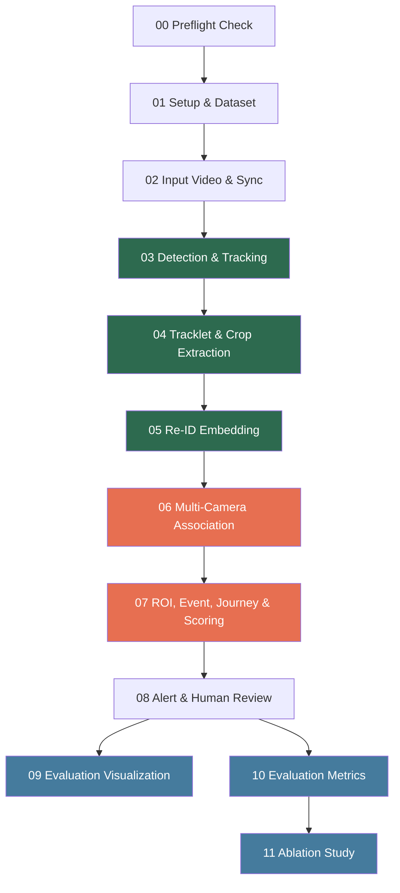

# Full Project Overview: Ticket Suspicion Multi-Camera Video Analytics
# Version 2.0 — Cập nhật theo nhận xét giảng viên

---

## 1. Problem & Objective

**Problem**: Phát hiện người nghi vấn chưa mua vé tại khu du lịch mở (bối cảnh Hội An) bằng phân tích video đa camera tự động.

**System Goal**: Tạo **cảnh báo nghi vấn** kèm bằng chứng trực quan để **nhân viên xác minh thủ công**. Hệ thống KHÔNG tự kết luận vi phạm pháp lý.

**Scientific Contribution**: Kết hợp Computer Vision (detection, tracking, Re-ID) với business logic (ROI, journey state, scoring) vào một pipeline end-to-end cho bài toán giám sát thực tế. Đặc biệt:
- Framework đồ thị bằng chứng không gian-thời gian để liên kết tracklet đa camera
- Cơ chế "từ chối kết luận" (uncertain state) khi bằng chứng không đủ chắc chắn
- Scoring có hiệu chỉnh độ bất định dựa trên Re-ID confidence

---

## 2. Ba Câu hỏi Nghiên cứu

> Theo nhận xét giảng viên: "Thu gọn nghiên cứu về ba câu hỏi vừa đủ để dẫn dắt phần phương pháp, dữ liệu và thí nghiệm."

**RQ1**: Khi kết hợp đặc trưng ngoại hình (Re-ID) với topology camera, thời gian di chuyển và tín hiệu vùng vé, hệ thống cải thiện khả năng phát hiện trường hợp thiếu bằng chứng xác thực đến mức nào so với pipeline dựa trên ngưỡng đơn giản?

**RQ2**: Việc hiệu chỉnh độ bất định và cho phép hệ thống từ chối kết luận (trạng thái `uncertain_insufficient_evidence`) có giảm cảnh báo sai và khối lượng kiểm tra thủ công mà vẫn giữ được độ nhạy hay không?

**RQ3**: Phương pháp có duy trì kết quả khi thay đổi ngày ghi hình, camera, mật độ người và điều kiện ánh sáng hay không? (Khả năng tổng quát hóa)

> **Nếu chưa có dữ liệu thực để trả lời đầy đủ**: Bài viết được xác định là **nghiên cứu khả thi**. Phần kết luận chỉ nên nói rằng pipeline đã vận hành trọn quy trình và chỉ ra kế hoạch kiểm chứng tiếp theo.

---

## 3. Pipeline Workflow — 12 Notebooks



> Green = Real MOT17 data | Orange = Partial simulation | Blue = Evaluation & Analysis

---

### NB00 — Preflight Check
- Validates directory structure, source files, config YAML
- Checks Python dependencies, YOLO model, GPU availability
- Scans MOT17 local dataset (seqinfo, sample images)
- Output: `00_preflight_check_results.csv`, `dataset_preflight_report.csv`

### NB01 — Setup & Dataset
- Detects project root (Vast.ai `/workspace`, Colab `/content`, or local)
- Creates directory tree and 4 YAML config files if missing
- Lists MOT17 sequences in `data/raw/MOT17/train`

### NB02 — Input Video & Sync
- Reads `camera_config.yaml` to determine data sources
- Scans MOT17 sequences in `train/` (7 scenes)
- Builds `frame_index.csv` with timestamp and metadata per frame
- Output: `outputs/frames/frame_index.csv`

### NB03 — Detection & Tracking
- Builds frame_index from MOT17/train, assigns `camera_id = sequence_name`
- **YOLOv8n** person detection (class=0, conf >= 0.35)
- **ByteTrack** multi-object tracking (`persist=True` per camera group)
- Tracker resets naturally between scenes (different camera_id)
- Output: `outputs/tracks/tracks.csv`

### NB04 — Tracklet & Crop Extraction
- Groups consecutive detections into tracklets (same camera_id + track_id)
- Computes metrics: duration, avg_confidence, avg_bbox_height
- Filters by config: min_frames=10, min_duration=1s, min_height=40px
- Selects top-K crops by quality (confidence + area + sharpness)
- Output: `outputs/tracklets/tracklets_summary.csv`, `outputs/crops/representative_crops.csv`

### NB05 — Re-ID Embedding
- Loads **OSNet (x1_0)** pretrained model
- Extracts 512-dim embeddings for each crop
- L2-normalizes, aggregates mean embedding per tracklet
- Output: `outputs/embeddings/crop_embeddings.npy`, `tracklet_embeddings.npy` + metadata CSVs

### NB06 — Multi-Camera Association & Global ID
- **Enhanced simulation**: Multi-difficulty noise (easy/medium/hard)
  - Easy: noise std=0.02
  - Medium: noise std=0.05
  - Hard: noise std=0.08 + 15% feature masking (partial occlusion)
- Difficulty assigned based on crop quality scores
- 60% of tracklets "appear at ticket counter"
- Cosine similarity + Hungarian matching
- Output: `outputs/associations/associations.csv`, `outputs/global_ids/global_ids.csv`

### NB07 — ROI Event, Journey & Scoring
- **Realistic event simulation**:
  - Poisson arrival process (inter-arrival ~ Exponential, ~3 people/min)
  - 30% group arrivals (2-4 people within 3s window)
  - Travel time ~ Normal(mu=180s, sigma=60s), clipped [30, 600s]
  - Dwell time ~ Log-normal (median ~20s), clipped [5, 120s]
- `build_journey_states()` -> **5 trạng thái** (Version 2.0):
  - `observed` | `ticket_evidence_found` | `waiting_for_ticket_evidence`
  - **`uncertain_insufficient_evidence`** (MỚI: khi reid_confidence < 0.60)
  - `suspected_no_ticket_evidence`
- `compute_suspicion_score()` -> weighted sum [0,1] với uncertainty calibration
- `alert_level_from_journey_state()` -> high/medium/low (xử lý đúng uncertain state)
- Output: `outputs/events/events.csv`, `outputs/journeys/journey_states.csv`, `outputs/alerts/alerts.csv`

### NB08 — Alert & Human Review
- Filters `high` alerts, copies top 3 crops to evidence folder
- Creates `summary.json` per alert with score and reason
- Creates `human_review.csv` (human_decision = "pending")

### NB09 — Evaluation Visualization
- Aggregate statistics and per-sequence breakdown
- **Qualitative Analysis**: Tracking visualization, crop quality showcase, alert examples
- **Failure Case Analysis**: Tracking fragmentation, false alerts, detection density
- Scoring sensitivity chart (alert count vs threshold)
- Alert distribution charts (status, score, journey state)
- Thesis table exports

### NB10 — Evaluation Metrics (Version 2.0)
- **⚠️ Phân biệt rõ 2 nhóm kết quả**: MOT17 GT vs Simulation
- **Nhóm A (MOT17 GT)**: CLEAR MOT Metrics (MOTA, Precision, Recall, F1 per sequence)
- **IDF1 (Identity F1)** — chỉ số mới theo đề xuất chỉnh sửa
- **Cross-Scene Re-ID Evaluation**: Positive/negative similarity histograms, ROC curve, AUC
- **Monte Carlo Validation**: 500-iteration scoring stability test
- Tracklet quality table, association statistics, evidence coverage
- Thesis summary table với phân biệt Nhóm A/B

### NB11 — Ablation Study (Version 2.0)
- **Sensitivity Analysis (Loại 1)** — đã có:
  - **min_frames**: Tests [3,5,8,10,15,20,30] -> optimal range 8-15, current: 10
  - **Re-ID threshold**: Tests [0.3-0.90] -> optimal range 0.50-0.65, current: 0.55
  - **Scoring weights**: Tests 5 configurations -> default recommended
  - **Alert threshold**: Tests [0.40-0.90] -> 0.70 confirmed balanced
- **Feature Ablation (Loại 2) — MỚI** theo đề xuất chỉnh sửa:
  - `full`: Re-ID + topology + time + ticket zone
  - `no_reid`: Không có Re-ID embedding
  - `no_time`: Không có time constraint
  - `no_ticket_zone`: Không có ticket zone signal (50% random)
  - `threshold_only`: Baseline đơn giản

---

## 4. Technical Architecture

### Models

| Component | Model | Details |
|-----------|-------|---------|
| Detection | **YOLOv8n** | Lightweight, real-time, COCO pretrained |
| Tracking | **ByteTrack** | SOTA MOT tracker, low-confidence association |
| Re-ID | **OSNet x1_0** | Omni-Scale feature learning, 512-dim |
| Matching | **Hungarian Algorithm** | Optimal assignment, cosine similarity |
| Scoring | **Rule-based + Uncertainty** | Weighted sum với uncertainty calibration |

### Source Code Modules (`src/`)

| Module | Function |
|--------|----------|
| `config.py` | Project root detection, YAML I/O, directory setup |
| `io_utils.py` | CSV/JSON/NumPy read/write |
| `dataset_preflight.py` | MOT dataset validation and reporting |
| `video_sync.py` | Frame index from sequences/video, seqinfo parsing |
| `roi_utils.py` | Point-in-polygon, line crossing detection |
| `journey_state.py` | Journey state classification (5 states) + uncertainty handling |
| `scoring.py` | Suspicion scoring + uncertainty calibration + alert level mapping |
| `evidence.py` | Evidence packaging + summary JSON |

### Configuration (4 YAML files)

| File | Content |
|------|---------|
| `pipeline_config.yaml` | Detector, tracker, tracklet, Re-ID, association params |
| `camera_config.yaml` | Camera sources, fps, sequence keywords |
| `roi_config.yaml` | Entrance line, ticket zone, queue zone polygons |
| `scoring_config.yaml` | Alert thresholds (0.70/0.50), weights, max travel time |

---

## 5. Data Flow

```
MOT17/train (7 scenes)
  |
  +--[NB03]--> tracks.csv (bbox + track_id per frame)
  |              |
  +--[NB04]--> tracklets_summary.csv + representative_crops.csv
  |              |
  +--[NB05]--> crop_embeddings.npy + tracklet_embeddings.npy
  |              |
  +--[NB06]--> associations.csv + global_ids.csv  (enhanced simulation)
  |              |
  +--[NB07]--> events.csv + journey_states.csv + alerts.csv  (realistic simulation)
  |              |
  +--[NB08]--> evidence/ + human_review.csv
  |              |
  +--[NB09]--> evaluation charts + qualitative visualizations
  |              |
  +--[NB10]--> CLEAR MOT metrics + IDF1 + Re-ID eval + Monte Carlo
  |              |
  +--[NB11]--> sensitivity analysis + feature ablation study
```

---

## 6. Scoring Formula

```
suspicion_score =
    0.25 x entered_area       +   # Entered monitored area?
    0.30 x no_ticket_evidence  +   # No ticket evidence? [PRIMARY SIGNAL]
    0.20 x time_exceeded       +   # Exceeded allowed time?
    0.10 x track_quality       +   # Tracking quality (0-1)
    0.15 x assoc_confidence        # Re-ID match confidence (0-1)

# Uncertainty calibration (Version 2.0):
if reid_confidence < 0.60:
    score = score * (reid_confidence / 0.60)  # Penalize uncertain matches

Alert levels:
    >= 0.70 -> HIGH (alert_generated)   -> Evidence + human review
    >= 0.50 -> MEDIUM (watchlist)       -> Monitoring
    < 0.50  -> LOW (no_alert)           -> Dismissed

Journey states (Version 2.0 — 5 states):
    uncertain_insufficient_evidence -> always LOW (never alert)
```

---

## 7. Evaluation Components

### 7.1 Nhóm A — Kết quả đo trên MOT17 GT

| Metric | Available | Notes |
|--------|-----------|-------|
| Detection P/R/F1 per-sequence | Yes | vs MOT17 GT, 7 scenes |
| MOTA per-sequence | Yes | Custom implementation |
| **IDF1 per-sequence** | Yes (v2.0) | Identity continuity metric — MỚI |
| Cross-Scene Re-ID ROC/AUC | Yes | Positive vs negative pairs |
| Monte Carlo stability | Yes | 500 iterations, mean ± std |
| Tracklet quality per-sequence | Yes | Valid ratio, duration, confidence |

### 7.2 Nhóm B — Kết quả từ mô phỏng (không có ground truth)

| Metric | Available | Notes |
|--------|-----------|-------|
| Ticket evidence rate | Yes (simulation) | 60.2% — được thiết kế |
| Alert distribution | Yes (simulation) | 145 high / 15 watch / 204 none |
| Suspicion score distribution | Yes (simulation) | Bimodal by design |
| Journey state distribution | Yes (simulation) | Bao gồm uncertain state |

> ⚠️ Nhóm B KHÔNG thể dùng để đánh giá hiệu năng thực sự — chỉ minh họa pipeline chạy end-to-end.

### 7.3 Qualitative Analysis (NB09)

| Visualization | Available | Notes |
|---------------|-----------|-------|
| Tracking per-sequence | Yes | Bbox + track ID on sample frames |
| Crop quality showcase | Yes | Best vs worst 5 crops |
| Alert examples | Yes | Top 3 high + 3 low with details |
| Scoring sensitivity | Yes | Alert count vs threshold curve |
| Alert distributions | Yes | Status, score, journey state charts |

### 7.4 Ablation Study (NB11 — Version 2.0)

| Type | Parameters Tested | Current Value |
|------|------------------|---------------|
| **Sensitivity (Loại 1)** | min_frames [3-30] | 10 (optimal: 8-15) |
| **Sensitivity (Loại 1)** | Re-ID threshold [0.3-0.90] | 0.55 (optimal: 0.50-0.65) |
| **Sensitivity (Loại 1)** | Scoring weights (5 configs) | default |
| **Sensitivity (Loại 1)** | Alert threshold [0.40-0.90] | 0.70 (balanced) |
| **Feature Ablation (Loại 2) MỚI** | full / no_reid / no_time / no_ticket_zone / threshold_only | full |

---

## 8. Kế hoạch Dữ liệu Thực (Theo đề xuất giảng viên)

### Tại sao cần dữ liệu thực?
MOT17 không có: camera quầy vé, log giao dịch, nhãn liên kết người giữa các camera, nhãn mua vé.

### Bộ nhãn tối thiểu cần có:
1. ID của người trong từng camera + liên kết giữa các camera
2. Timestamp đi vào, xuất hiện tại vùng vé, rời khỏi, đoạn bị che khuất
3. Nhãn sự kiện: có bằng chứng xác thực / thiếu bằng chứng / không xác định
4. Tình huống phức tạp: đi theo nhóm, mua hộ, đi vòng, mua trễ, camera mất tín hiệu

### Yêu cầu gán nhãn:
- ≥2 người gán nhãn độc lập
- Có quy tắc hòa giải cho bất đồng
- Báo cáo inter-annotator agreement (Cohen's kappa hoặc tương tự)

### Quy mô mẫu:
- Tính theo số SỰ KIỆN (không phải frame)
- Để đo sensitivity ~0.85, sai số ±0.05, CI 95% → cần ~196 sự kiện dương
- Thực tế cần nhiều hơn do tương quan (cluster bootstrap theo ngày/camera/phiên)

### Chia tập dữ liệu:
- Chia theo phiên ghi hình hoặc ngày, KHÔNG chia ngẫu nhiên theo frame
- Toàn bộ hình ảnh một người phải nằm trong cùng một tập (tránh data leakage)

---

## 9. Metrics Chính (Theo đề xuất giảng viên)

Khi báo cáo kết quả trên dữ liệu thực (khi có), sử dụng các chỉ số sau:

### Tracking & Re-ID
- **HOTA, DetA, AssA** (Higher-Order Tracking Accuracy — Luiten et al. 2021)
- **IDF1** (Identity F1)
- **ID Switches**
- **mAP, Rank-1** (cho Re-ID)

### Kết quả chính của hệ thống (cấp sự kiện)
- **PR-AUC** (precision-recall area under curve)
- **Precision, Recall, F1** tại cấp sự kiện (không phải frame)
- **Số cảnh báo sai mỗi giờ** (false alerts per hour)
- **Số sự kiện bị bỏ sót** (missed events)
- **Thời gian từ khi người đi vào đến khi có cảnh báo** (latency)

> Mỗi kết quả chính cần khoảng tin cậy 95% (bootstrap hoặc cluster bootstrap).

---

## 10. Improvement Proposals Status

| # | Proposal | Status | Location |
|---|----------|--------|----------|
| 1 | CLEAR MOT Metrics (MOTA, IDF1) | Done (v2.0) | NB10 |
| 2 | Cross-Scene Re-ID Evaluation | Done | NB10 (ROC, AUC, histograms) |
| 3 | Qualitative Analysis | Done | NB09 (tracking viz, crops, alerts) |
| 4 | Enhanced Simulation | Done | NB06+NB07 (multi-difficulty, Poisson) |
| 5 | Ablation Study (Sensitivity) | Done | NB11 (4 experiments) |
| 6 | Feature Ablation (đúng nghĩa) | Done (v2.0) | NB11 (5 feature configs) |
| 7 | Failure Case Analysis | Done | NB09 (fragmentation, false alerts) |
| 8 | End-to-End Run Script | Done | run_pipeline.py |
| 9 | Monte Carlo Validation | Done | NB10 (500 iterations) |
| 10 | Uncertain State (từ chối kết luận) | Done (v2.0) | src/journey_state.py, src/scoring.py |
| 11 | Phân biệt kết quả MOT17 vs Simulation | Done (v2.0) | NB10, RESULT-OVERVIEW.md |

### Công việc còn lại (cần dữ liệu thực)
- **Pilot dataset**: Thu thập tại khu vực thực tế
- **Annotated ground truth**: ≥2 annotators, inter-annotator agreement
- **Event-level evaluation**: PR-AUC, precision/recall/F1 trên sự kiện thực
- **Generalization test**: Đo kết quả khi thay đổi ngày/camera/mật độ/ánh sáng

---

## 11. Tài liệu Tham khảo Bổ sung (Theo đề xuất giảng viên)

### Multi-Camera Tracking
- Cheng, D. et al. (2023). **ReST: A Reconfigurable Spatial-Temporal Graph Model for Multi-Camera Multi-Object Tracking**. ICCV.
- Woo, S. et al. (2024). **MTMMC: A Large-Scale Real-World Multi-Modal Camera Tracking Benchmark**. CVPR.
- Fan, Z. et al. (2025). **All-Day Multi-Camera Multi-Target Tracking**. CVPR.

### Metrics
- Luiten, J. et al. (2021). **HOTA: A Higher Order Metric for Evaluating Multi-Object Tracking**. International Journal of Computer Vision, 129, 548–578.

### Domain Shift & Generalization
- Li, S. & Gong, S. (2024). **Mitigate Domain Shift by Primary-Auxiliary Objectives Association for Generalizing Person Re-Identification**. WACV.

### Privacy
- Kansal, K. et al. (2024). **Privacy-Enhancing Person Re-Identification Framework: A Dual-Stage Approach**. WACV.

### Video Anomaly Detection
- Karim, N. et al. (2024). **Real-Time Weakly Supervised Video Anomaly Detection**. WACV.
- Wu, P. et al. (2024). **Open-Vocabulary Video Anomaly Detection**. CVPR.

### Ticket/Fare Evasion Detection
- Huang, Y. et al. (2022). **Video-based fare evasion detection at metro gates**. Information Sciences.

---

## 12. Conclusion

Dự án cung cấp một **pipeline end-to-end hoàn chỉnh** từ video input đến alert output, với:

1. **Real CV components** (detection, tracking, Re-ID) chạy trên 7 MOT17 scenes với evaluation vs ground truth
2. **Realistic simulation** cho business logic (multi-difficulty association noise, Poisson arrivals, group dynamics)
3. **Comprehensive evaluation** (CLEAR MOT, IDF1, Re-ID ROC, qualitative analysis, failure cases, ablation study gồm feature ablation, Monte Carlo)
4. **Uncertainty handling**: Trạng thái `uncertain_insufficient_evidence` + uncertainty-calibrated scoring
5. **Ethical design** với human-in-the-loop, không auto-conclude vi phạm
6. **Reproducible** với config-driven parameters, end-to-end run script, và smoke test

Đây là **nghiên cứu khả thi (feasibility study)** với kết quả pipeline đầy đủ trên MOT17.
Validation thực sự đòi hỏi dữ liệu đa camera thật với ground truth được gán nhãn bởi con người.
